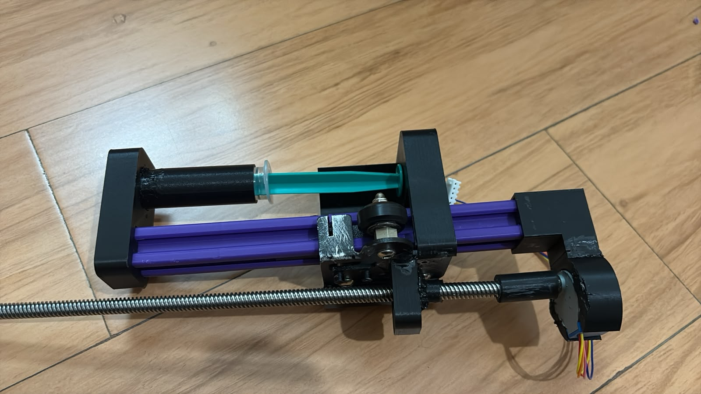
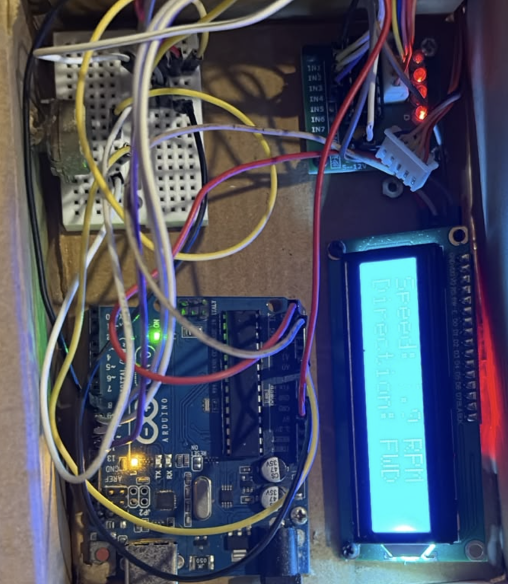
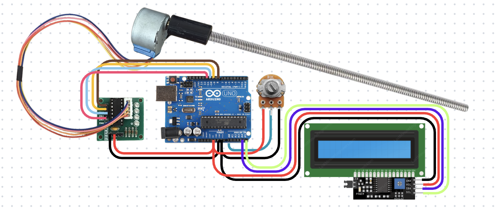

# Syringe Pump!

A smallish, mostly 3D printed syringe pump built around an Arduino Uno, a 28BYJ48 stepper motor, Ender roller and a T8 lead screw. The idea was to make a simple mechanism that can push a syringe plunger at a adjustable rate.
The entire mechanical assembly is custom 3D printed, with a linear carriage that moves along an extrusion and pushes the syringe plunger. The servo is controlled using a potentiometer so that the flow rate can be adjusted while the pump is running.

## Why?

For a larger prototype I am working on, I needed a way to move fluid through a system at a controlled rate. Instead of using a manually operated syringe or trying to control the flow by hand (basically impossible) , I wanted to build a small motorised mechanism that could push the syringe at a consistent speed.

Commercial syringe pumps ARE VERRRYYYY expensive (60$+), especially when all I really needed was a relatively simple mechanism with adjustable flow. I decided to build 1 myself, using readily available electronics and 3D printed parts, combining the parts i and eshant had, we had all the parts so there was no need to buy anything!

## How it works

The main structure is built around an extrusion which acts as the guide for the moving carriage. At one end, a 28BYJ48 stepper motor drives a T8 threaded lead screw. As the screw rotates, it moves a constrained carriage forward or backward along the extrusion. The carriage rides on rollers and has a pusher attached to it, which presses against the syringe plunger.

At the other end of the extrusion is a separate syringe holder. The syringe sits between the holder and the moving carriage, with its plunger facing the carriage. When the motor turns the lead screw, the carriage moves towards the syringe and pushes the plunger, displacing the liquid inside it. Reversing the motor moves the carriage in the opposite direction.

The syringe holder and the other mechanical components are custom designed and 3D printed. The syringe itself is removable, so different syringes can be fitted without having to rebuild the entire mechanism.

### If this is confusing, please watch the video here -> https://youtu.be/-r1Smpq4tX8

## Electronics

Electronics are p simple, the wiring diagram shows everything

## Some simple calculations

Ok this is some interesting stuff, The flow rate depends on 2 things: how far the plunger moves and the internal area of the syringe barrel. For this build, the lead screw has a pitch of 2 mm and 4 starts, giving a lead of 8 mm per revolution. This means that one complete rotation moves the carriage by 8 mm.

Also idk if latex will work , its weird, depends on how github is feeling lol

The volume displaced in 1 revolution is therefore:
The volume displaced per revolution is:

$$
V = \frac{\pi D^2}{4} \times L
$$

Where:
- D is the internal diameter of the syringe barrel in mm.
- L is the lead screw lead in mm per revolution.

The flow rate is then calculated using:

$$
Q = \frac{\pi D^2}{4} \times \frac{L \times RPM}{60000}
$$

The result will bein mL/s.

If u didnt understand pls go back to 8th grade and learn physics.... /j (sry to all the 7th graders reading this)

## Firmware
All the codes in the firmware folder 

To get it running, install the libraries mentioned in firmware readme, open the cpp file, select the Arduino Uno as the board and upload the code, THATS IT.

The current pin configuration is: (formatted by chatgpt cus idk how to make a table in .md)

<table>
<tr>
<td valign="top">

**Pin Connections**

| Component | Arduino pin |
|---|---|
| ULN2003 IN1 | D8 |
| ULN2003 IN2 | D9 |
| ULN2003 IN3 | D10 |
| ULN2003 IN4 | D11 |
| Potentiometer output | A0 |
| LCD SDA | A4 |
| LCD SCL | A5 |

LCD I2C address: `0x27`

</td>
<td valign="top">

**Firmware Variables**

| Variable | Value | Purpose |
|---|---:|---|
| `Diameter` | 16.0 mm | Internal syringe diameter |
| `Lead_MM` | 8.0 mm | Lead screw movement per revolution |
| `Steps_per_rev` | 4096 | Approximate motor output steps per revolution |
| `max_rpm` | 10.0 | Maximum lead screw RPM |
| `deadzone` | 35 | Potentiometer centre deadzone |

</td>
</tr>
</table>

## BOM

We alr had all the components so it was free for us. (formatted by chatgpt cus idk how to make a table in .md)
| Component | Details | Quantity | Price |
|---|---|---:|---:|
| 3D printed parts | Most of the parts and relatively little filament used | 1  | ₹0 |
| Stepper motor + driver | 28BYJ48 5V with ULN2003 driver board | 1 | ₹100 |
| T8 lead screw | 8 mm diameter, 2 mm pitch, 4 start | 1 | ₹270 |
| LCD display | JHD162A or similar 16x2 LCD with I2C backpack | 1 | ₹180 |
| Arduino Uno | UNO R3  | 1 | ₹250 |
| **Total** | | | **₹800 ($8.55)** |
